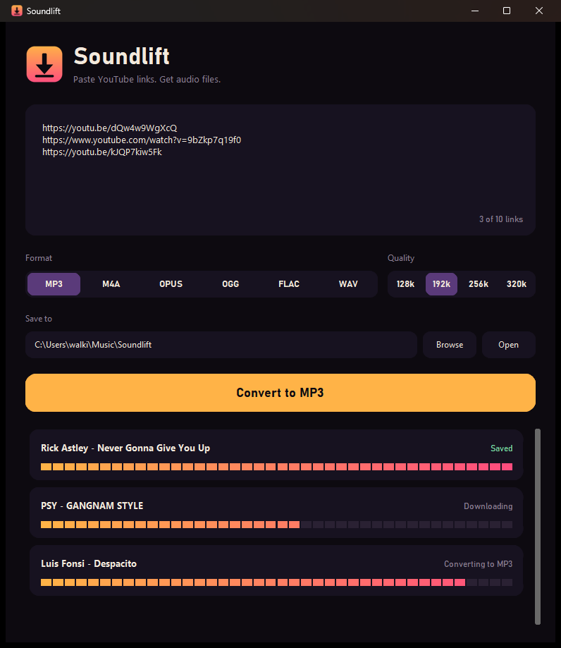



# Soundlift

**Paste YouTube links. Get audio files.**

Convert up to 10 links at once to MP3, M4A, Opus, OGG, FLAC or WAV.
Runs on your PC. No account, no install, no ads.

[-FFB347?style=for-the-badge&labelColor=0D0A10)](https://github.com/walkingcorpses/soundlift-releases/releases/latest)

## Download and run

1. Get **Soundlift-1.0.0-windows.zip** from the [latest release](https://github.com/walkingcorpses/soundlift-releases/releases/latest).
2. Unzip it anywhere.
3. Open the `Soundlift` folder and double-click **Soundlift.exe**.
4. Paste up to 10 YouTube links, pick a format, press **Convert**.

Files land in `Music\Soundlift` unless you pick another folder.

> Windows SmartScreen may warn because the app is not code-signed. Click **More info**, then **Run anyway**.

## Formats

| Format | Type | Good for |
|--------|------|----------|
| MP3 | Lossy | Plays everywhere |
| M4A | Lossy | Apple devices, good quality per MB |
| Opus | Lossy | Best quality at small sizes |
| OGG | Lossy | Open format, wide player support |
| FLAC | Lossless | Archiving without losing quality |
| WAV | Lossless | Editing in audio software (large files) |

## Built with

[yt-dlp](https://github.com/yt-dlp/yt-dlp), [FFmpeg](https://ffmpeg.org), [CustomTkinter](https://github.com/TomSchimansky/CustomTkinter) and [PyInstaller](https://pyinstaller.org).

## Fair use

Only download content you own, that is licensed for it, or that you otherwise have the right to copy. You are responsible for what you download.
